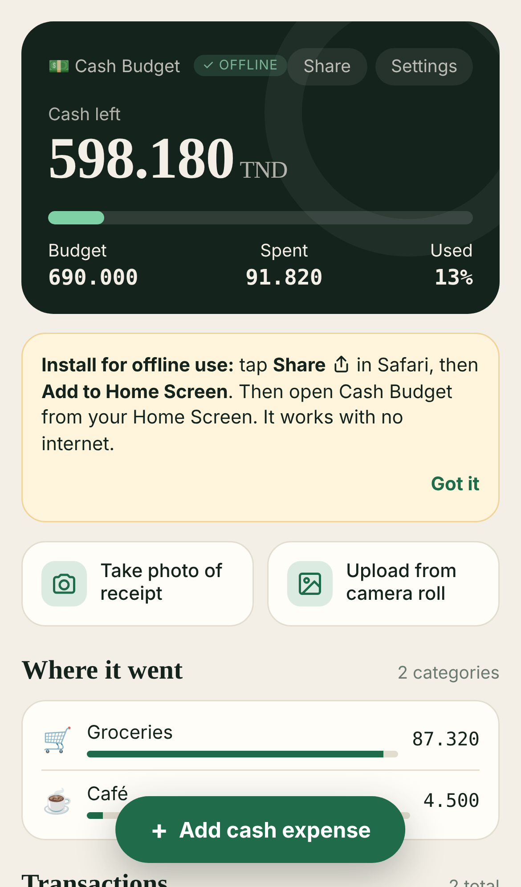
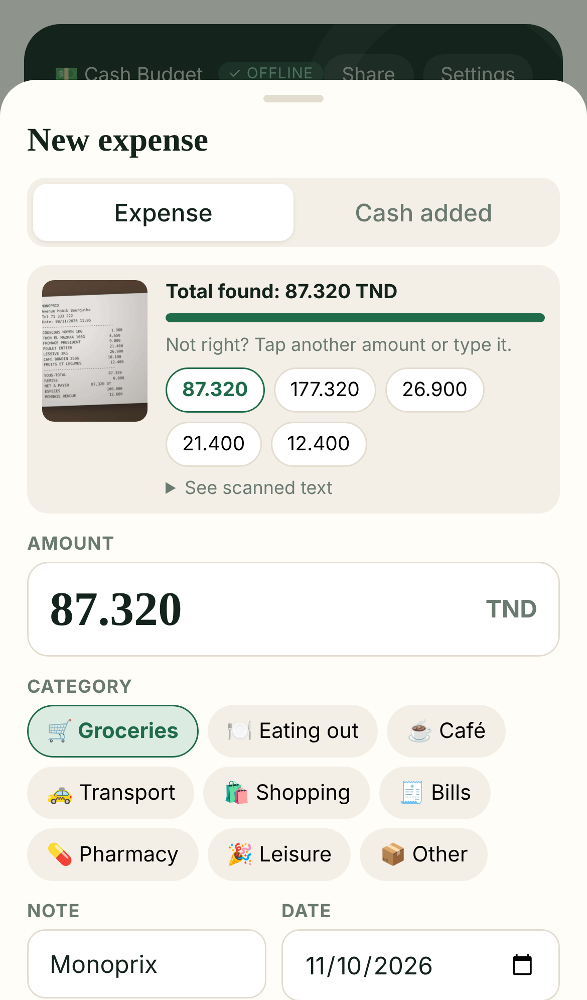

# Cash Budget (Tunisia)

An offline app for tracking cash spending in Tunisian dinars (TND), built for iPhone. Take a photo of a receipt, or pick one from the camera roll, and the app reads the total for you. The reading happens on the phone, with no internet and no uploads.

<p>


</p>

## Features

| | |
|---|---|
| **Works offline** | An installable web app (PWA). A service worker caches everything, including the 8 MB text reader, on the first visit. After that it runs in airplane mode. |
| **Receipt → amount** | Tesseract OCR (English + French) runs on the phone in WebAssembly. The parser knows Tunisian receipts: `NET A PAYER`, `TOTAL TTC`, `A PAYER`, 3-decimal dinars, `1 245,800`, `8.210 DT`. It skips `ESPECES`, `RENDU`, `TVA`, `SOUS-TOTAL` and `TIMBRE` lines, and checks the total against *cash given − change*. If the first guess is wrong, you tap one of the other amounts it found. |
| **Camera or camera roll** | "Take photo of receipt" opens the rear camera. "Upload from camera roll" opens Photos. iOS converts HEIC photos automatically. |
| **Pre-filled** | On first run the budget (690 TND) and the 9 categories are loaded from the original `Tunisia_cash_budget_v1.1.html` (`data/seed.json`). |
| **Persistent** | Data is kept in IndexedDB on the phone, and the app asks the browser for persistent storage. Receipt photos are kept too. |
| **Share with others** | You can share as a **file** (.json, photos optional) through the iPhone share sheet (WhatsApp, Messages, AirDrop, Mail…), as a **link** with the data packed inside it, or as a **text summary**. The recipient chooses *Add to mine* or *Replace mine*. Nothing passes through a server. |
| **Imports the old app** | *Settings → Import* reads backups (`.json`) and shared copies (`.html`) from the old single-file app. |

## Put it on your iPhone

1. Host the folder on any HTTPS static host. This repo deploys itself to **GitHub Pages**: in the repo go to *Settings → Pages → Build and deployment → Source: GitHub Actions*, then merge to `main`. The site is `https://<user>.github.io/tunisia-budget-tracker/`.
2. Open that link in **Safari** on the iPhone.
3. Tap **Share → Add to Home Screen**.
4. Open **Cash Budget** from the Home Screen. It now works offline. Data saved by the Home Screen app is kept by iOS.

> The app is static files only, with no backend and no tracking. Your data never leaves the phone unless you share it.

## Run locally

```bash
npm start            # http://localhost:8080
```

## Tests

```bash
npm run test:parser  # unit tests for total extraction (Node only)
npm run test:e2e     # full app in an emulated iPhone 13 (needs Playwright + Chromium)
npm run fixtures     # regenerate the test receipt images
```

The end-to-end test checks:

- the seeded budget and categories appear;
- the camera input opens the rear camera and the camera-roll input opens the photo library;
- the correct total is extracted from 7 receipts, both as clean scans and as tilted, blurred, JPEG "phone photos" (14 images), using both buttons;
- saved expenses persist across reloads;
- the app and receipt scanning work **offline**;
- sharing as a file reaches the share sheet with photos, another "phone" imports it, and link sharing and merging work;
- shared copies from the old app import correctly.

## Layout

```
index.html, css/app.css     UI (design carried over from v1.1)
js/app.js                   app logic
js/store.js                 IndexedDB storage
js/ocr.js, js/ocr-worker.js offline receipt reader (Tesseract in a Web Worker)
js/receipt-parser.js        finds the total in OCR text
js/share.js                 share/import (file, link, legacy formats)
data/seed.json              pre-filled data from Tunisia_cash_budget_v1.1.html
vendor/tesseract/           OCR engine + eng/fra language data (taken from v1.1)
sw.js, manifest.webmanifest offline + Home Screen install
tests/                      parser + end-to-end tests, fixture receipts
```
